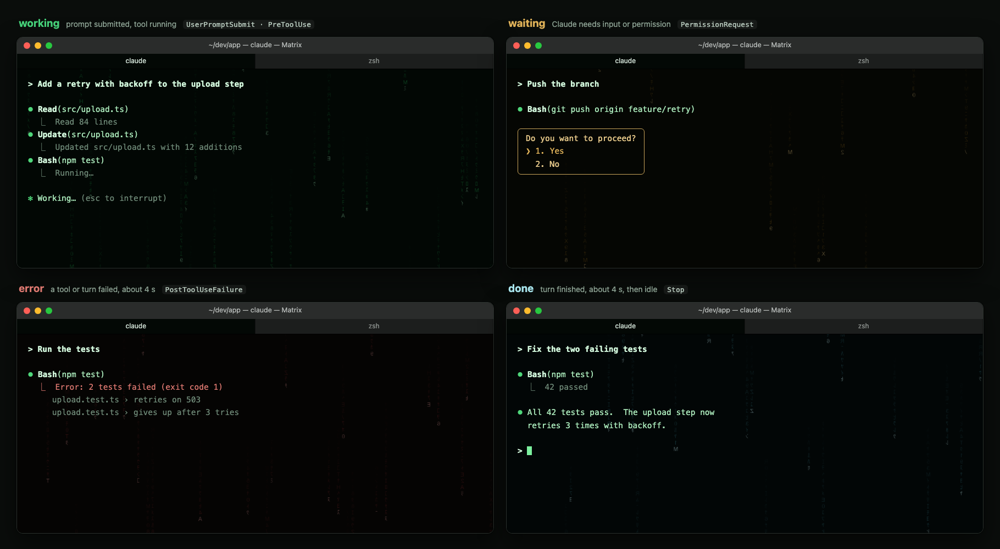
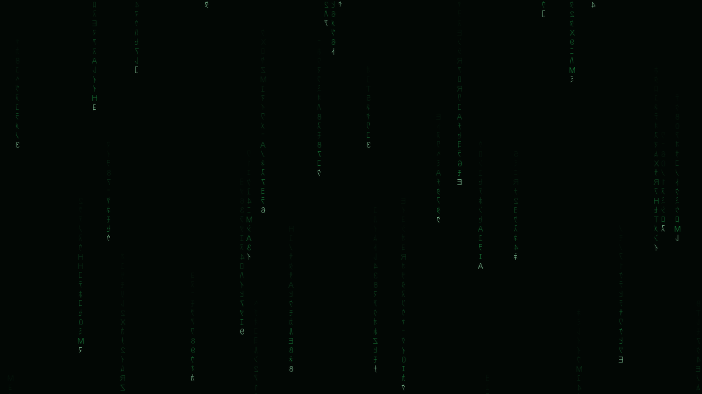
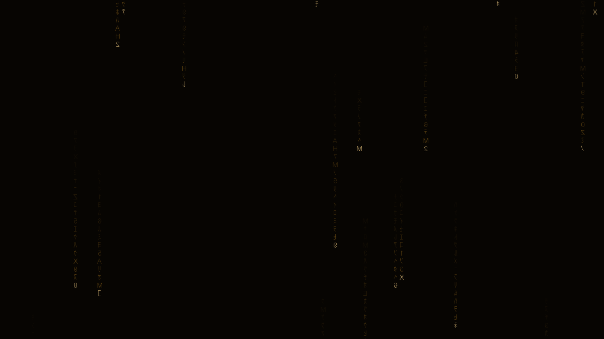

# iterm2-matrix-rain

A Matrix color theme for iTerm2 plus a soft, animated digital rain drawn behind the terminal text.  The rain's tint, tempo and density shift gently with Claude Code events: a prompt submitted, a tool running, Claude waiting for you, a tool failure, a finished turn.

Project page with mock screenshots and instructions: https://dharmaje.github.io/iterm2-matrix-rain/






## How it works

iTerm2 does not animate GIF backgrounds.  A small daemon renders soft PNG frames with Pillow and swaps each opted-in session's background image through the iTerm2 Python API.  Claude Code hooks send a one-line state event over a Unix socket, and the daemon eases the rain to the new palette over about a second.

## Requirements

- macOS with iTerm2 3.5 or newer
- Python 3.10 or newer (`python3`)
- iTerm2's Python API turned on: Settings > General > Magic > Enable Python API
- `jq` is optional; the hook falls back to `sed`

## Install

```bash
git clone https://github.com/dharmaje/iterm2-matrix-rain.git
cd iterm2-matrix-rain
./install.sh --install            # .venv, dependencies, Matrix Dynamic Profile
./install.sh --autolaunch         # start the daemon whenever iTerm2 starts
./install.sh --hooks              # prints the Claude Code hook JSON
```

Before it changes anything, `--install` (and `--autolaunch`) checks the dependencies and prints a table such as:

```text
Dependency             Required     Found          Status
macOS                  any          26.1           OK
iTerm2                 3.5+         3.7.6          OK
python3                3.10+        3.12.4         OK
osacompile             any          yes            OK
osascript              any          yes            OK
iTerm2 Python API      enabled      enabled        OK
jq (optional)          any          jq-1.7.1       OK
```

A missing or too-old dependency, or the Python API being off, stops the installer with one line saying what to install or turn on; nothing is written.  Once `.venv` exists, it compares the installed Python packages with `requirements.txt`.  Installing a missing package needs no answer, but upgrading one that is already installed shows the from and to versions and asks `Upgrade? [y/N]`.  Answering no stops with nothing changed.  Pass `--yes` to accept the prompts in a non-interactive run.

Then choose the **Matrix** profile.  Either make it the default (Settings > Profiles > Matrix > Other Actions > Set as Default) or open a window with it from the Profiles menu.  Only sessions using a profile named `Matrix` animate.

### Starting the daemon

`./install.sh --autolaunch` compiles `scripts/autolaunch.applescript` with your clone's path and installs it as `~/Library/Application Support/iTerm2/Scripts/AutoLaunch/iterm2-matrix-rain.scpt`.  iTerm2 runs the scripts in that folder each time it starts.  The script asks iTerm2 for an API cookie and key, then starts the daemon in the background with them, logging to `~/Library/Logs/iterm2-matrix-rain.log`.  It does nothing when a daemon is already running.  Because iTerm2 supplies the cookie itself, there is no "allow this script to connect" question.

To start it now without restarting iTerm2:

```bash
osascript ~/Library/Application\ Support/iTerm2/Scripts/AutoLaunch/iterm2-matrix-rain.scpt
```

The daemon exits when iTerm2 quits, so the next iTerm2 launch starts a fresh one.

A launchd LaunchAgent does not work.  A process that iTerm2 did not start has to fetch the cookie through AppleScript, and a launchd job has no Automation permission to do that, so the request never returns.  The daemon gives up after 15 seconds and logs why.

To run it by hand instead, from an iTerm2 terminal (iTerm2 may ask once whether to allow the connection):

```bash
.venv/bin/matrix-rain daemon
```

## Updates

Each time the daemon starts, before it connects to iTerm2, it:

1. Reads the installed iTerm2 version and logs it next to the version this was built for (iTerm2 3.7).  When the installed major.minor is newer, it posts one macOS notification per newer version, suggesting you check for an update if the rain misbehaves.  It never stops for a newer version, but it exits on anything older than 3.5.
2. Runs `git fetch origin` in this clone, with a 20 s limit and no output to the terminal.  It fast-forwards to origin's default branch only when the working tree is clean, HEAD is on that branch and no local commits would be lost.  Then it reinstalls `requirements.txt` into `.venv`, posts a notification naming the new version and restarts itself.  A dirty, diverged or offline clone logs one line and starts with the current code.

The check runs at most once an hour.  `matrix-rain daemon --update-now` or `matrix-rain update` forces it, and `matrix-rain version` prints the project version, the iTerm2 version it was built for and the installed one.  To turn updates off, or only be notified, put this in `~/.config/iterm2-matrix-rain/config.toml`:

```toml
[update]
auto = false          # skip the update step entirely
# check_only = true   # or: notify that an update exists, change nothing
```

## Claude Code hooks

`./install.sh --hooks` prints the block below with your clone's path filled in.  Merge it into `~/.claude/settings.json`; the installer never edits that file.

```json
{
  "hooks": {
    "SessionStart":       [{ "hooks": [{ "type": "command", "command": "/path/to/iterm2-matrix-rain/hooks/claude-code-hook.sh", "timeout": 5 }] }],
    "UserPromptSubmit":   [{ "hooks": [{ "type": "command", "command": "/path/to/iterm2-matrix-rain/hooks/claude-code-hook.sh", "timeout": 5 }] }],
    "PreToolUse":         [{ "matcher": "*", "hooks": [{ "type": "command", "command": "/path/to/iterm2-matrix-rain/hooks/claude-code-hook.sh", "timeout": 5 }] }],
    "PostToolUse":        [{ "matcher": "*", "hooks": [{ "type": "command", "command": "/path/to/iterm2-matrix-rain/hooks/claude-code-hook.sh", "timeout": 5 }] }],
    "PostToolUseFailure": [{ "matcher": "*", "hooks": [{ "type": "command", "command": "/path/to/iterm2-matrix-rain/hooks/claude-code-hook.sh", "timeout": 5 }] }],
    "PermissionRequest":  [{ "matcher": "*", "hooks": [{ "type": "command", "command": "/path/to/iterm2-matrix-rain/hooks/claude-code-hook.sh", "timeout": 5 }] }],
    "Notification":       [{ "hooks": [{ "type": "command", "command": "/path/to/iterm2-matrix-rain/hooks/claude-code-hook.sh", "timeout": 5 }] }],
    "Stop":               [{ "hooks": [{ "type": "command", "command": "/path/to/iterm2-matrix-rain/hooks/claude-code-hook.sh", "timeout": 5 }] }],
    "StopFailure":        [{ "hooks": [{ "type": "command", "command": "/path/to/iterm2-matrix-rain/hooks/claude-code-hook.sh", "timeout": 5 }] }],
    "SubagentStop":       [{ "hooks": [{ "type": "command", "command": "/path/to/iterm2-matrix-rain/hooks/claude-code-hook.sh", "timeout": 5 }] }],
    "SessionEnd":         [{ "hooks": [{ "type": "command", "command": "/path/to/iterm2-matrix-rain/hooks/claude-code-hook.sh", "timeout": 5 }] }]
  }
}
```

The hook prints nothing to stdout, hands the event to a background process and always exits 0, so it never slows or blocks Claude Code.

## States

| Claude Code event | State | Look |
|---|---|---|
| SessionStart | idle | deep dim green, slow, sparse |
| UserPromptSubmit, PreToolUse, PostToolUse | working | brighter green, faster, denser |
| Notification (permission_prompt, idle_prompt), PermissionRequest | waiting | amber, slow |
| PostToolUseFailure, StopFailure | error | muted crimson for about 4 s, then back to the previous state |
| Stop, SubagentStop | done | cool cyan-white for about 4 s, then idle |
| SessionEnd | off | fades to almost nothing |

Every change eases over about a second.  Events that arrive during an error or done hold update where the rain returns to, without cutting the hold short.

Send a state by hand:

```bash
.venv/bin/matrix-rain event working
.venv/bin/matrix-rain event --tty /dev/ttys003 waiting
```

## Configuration

Put overrides in `~/.config/iterm2-matrix-rain/config.toml`.  Any key you leave out keeps its default, and the daemon reads the file at start-up.  The defaults:

```toml
# iterm2-matrix-rain defaults.
# Copy any part of this file to ~/.config/iterm2-matrix-rain/config.toml to override it.
# Colors are [r, g, b] in 0-255.  Speeds are glyph cells per second.

[daemon]
profile = "Matrix"        # animate sessions whose profile has this name
fps = 6.0                 # frames per second for the focused window
idle_interval = 2.0       # seconds between frames for unfocused sessions
blend = 0.75              # iTerm2 Blend while animating; higher shows more rain, lower more background color
max_width = 1200          # frame width cap in pixels; iTerm2 stretches the frame
px_per_col = 8            # frame pixels per terminal column
px_per_row = 16           # frame pixels per terminal row
transition = 1.0          # seconds to ease between states
discover_interval = 5.0   # seconds between scans for sessions to animate

# Self-update.  Before connecting to iTerm2 the daemon runs `git fetch origin`
# in this clone (20 s limit) and fast-forwards to origin's default branch, but
# only when the working tree is clean, HEAD is on that branch and no local
# commits would be lost.  It then reinstalls requirements.txt into the venv,
# posts a notification and restarts itself.  Any failure is logged and the
# daemon starts with the current code.  The check runs at most once an hour;
# `matrix-rain daemon --update-now` or `matrix-rain update` forces it.
[update]
auto = true               # false skips the update step entirely
check_only = false        # true: only notify that an update is available
min_interval = 3600       # seconds between checks

[render]
cell_width = 12           # rain glyph cell size in frame pixels
cell_height = 16
font_size = 14
mirror = true             # mirror glyphs horizontally, as in the film
glow = 0.55               # strength of the soft halo around each glyph
glow_radius = 2.0
tail_min = 8              # tail length range in cells
tail_max = 26
tail_gamma = 1.6          # higher = tail fades sooner
buckets = 16              # brightness levels cached per glyph
fonts = [
  "/System/Library/Fonts/Supplemental/Arial Unicode.ttf",
  "/System/Library/Fonts/Hiragino Sans GB.ttc",
  "/System/Library/Fonts/ヒラギノ角ゴシック W3.ttc",
  "/Library/Fonts/Arial Unicode.ttf",
]
latin_fonts = [
  "/System/Library/Fonts/Menlo.ttc",
  "/System/Library/Fonts/Monaco.ttf",
]

# Each state: tail and head colors, background, speed, density (share of
# columns running a stream), brightness (overall multiplier) and mutation
# (glyph changes per cell per second).  Transient states also have
# hold (seconds) and next ("previous" or a state name).

[states.idle]
background = [2, 6, 4]
tail = [20, 120, 55]
head = [120, 200, 150]
speed = 5.0
density = 0.28
brightness = 0.70
mutation = 0.6

[states.working]
background = [2, 7, 4]
tail = [30, 165, 75]
head = [160, 235, 185]
speed = 10.0
density = 0.48
brightness = 0.90
mutation = 1.4

[states.waiting]
background = [7, 5, 2]
tail = [150, 105, 25]
head = [235, 200, 130]
speed = 3.5
density = 0.32
brightness = 0.80
mutation = 0.5

[states.error]
background = [8, 3, 3]
tail = [140, 35, 40]
head = [215, 140, 140]
speed = 6.0
density = 0.36
brightness = 0.80
mutation = 1.0
hold = 4.0
next = "previous"

[states.done]
background = [3, 6, 8]
tail = [60, 150, 165]
head = [190, 230, 235]
speed = 6.0
density = 0.34
brightness = 0.85
mutation = 0.8
hold = 4.0
next = "idle"

[states.off]
background = [1, 2, 1]
tail = [10, 40, 20]
head = [40, 70, 50]
speed = 2.0
density = 0.03
brightness = 0.12
mutation = 0.2
```

Preview a palette without iTerm2:

```bash
.venv/bin/matrix-rain preview /tmp/rain.png --state error
```

## Performance

Measured on an Apple silicon Mac with iTerm2 3.7.6 and a 209x51 window:

| Measure | Value |
|---|---|
| Frame render plus PNG encode (1200x586) | about 8 ms |
| One background swap through the API | about 10 ms |
| iTerm2 CPU, no animation | 4 to 8% |
| iTerm2 CPU, animating at 6 fps | 22 to 24% |
| iTerm2 CPU, 10 fps full-window frames (early probe) | about 31% |

Only sessions in the selected tab of the frontmost iTerm2 window animate at full rate, and only while iTerm2 is the active app.  Everything else gets one frame every 2 seconds.  Lower `fps` in the config to trade smoothness for CPU.

## Troubleshooting

- **Nothing animates.**  Check the session's profile is named `Matrix` (or start the daemon with `--session <id>`), the Python API is on, and the daemon is running: `pgrep -fl matrix_rain`.  The AutoLaunch daemon logs to `~/Library/Logs/iterm2-matrix-rain.log`; a line saying it could not connect within 15 s means it was started outside iTerm2 without a cookie.
- **An animated GIF background shows one still frame.**  That is iTerm2's behavior; this project exists because of it.
- **Events reach the wrong window, or none, inside tmux.**  Inside tmux, `$ITERM_SESSION_ID` belongs to whichever shell started the tmux server.  The event command asks tmux for the client tty instead (`tmux display -p '#{client_tty}'`) and the daemon maps that tty to the iTerm2 session.  Run `matrix-rain event working -v` from the pane to see what it resolved.
- **iTerm2 asks to allow the script.**  That happens only when you start the daemon by hand; choose to always allow it, or use the AutoLaunch script.
- **The rain is too faint or too strong.**  Raise or lower `blend` under `[daemon]` (higher shows more rain; 0.6 is the default, 0.3 is barely visible) or `brightness` per state.
- **The log says "update: refuse, working tree has local changes".**  Your clone has edits, so it is not updated automatically.  Commit or stash them, or keep `[update] auto = false`.
- **A notification says iTerm2 is newer than the version this was built for.**  Usually harmless.  If the rain misbehaves, run `matrix-rain update` or check the repository for a newer release.
- **Stop it and clean up.**  Stop the daemon with `kill <pid>`; it restores each session's background on SIGTERM.  `./install.sh --uninstall` removes everything it installed.

## Self-test

```bash
.venv/bin/matrix-rain selftest
```

Checks frame sizes and softness, state interpolation, the hook's event mapping with both `jq` and `sed`, iTerm2 version comparison, the update decision (with throwaway git repositories) and the installer's version comparison and preflight (with a stubbed `defaults`), all without iTerm2.

## License

MIT.  See [LICENSE](LICENSE).
